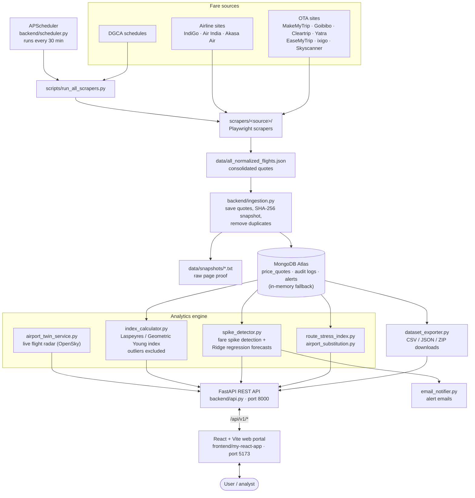
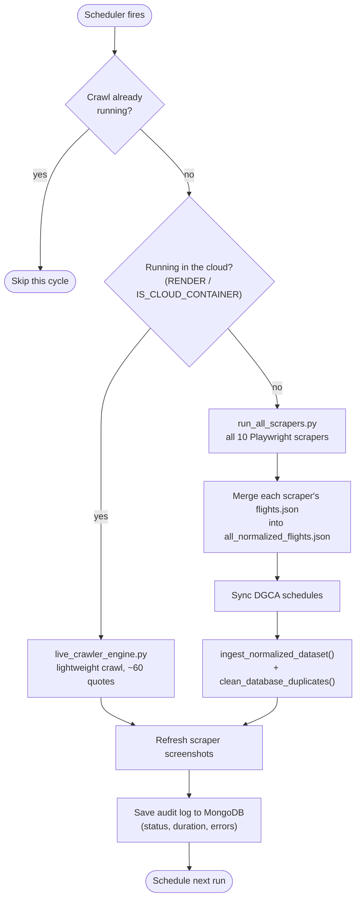
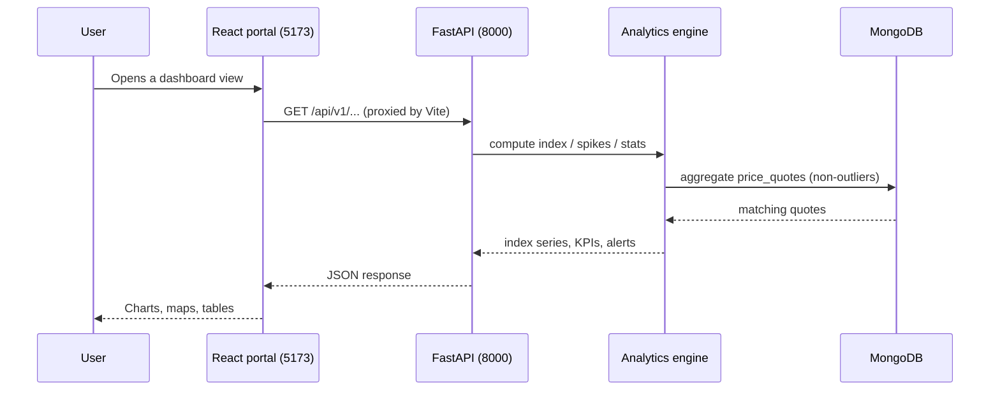
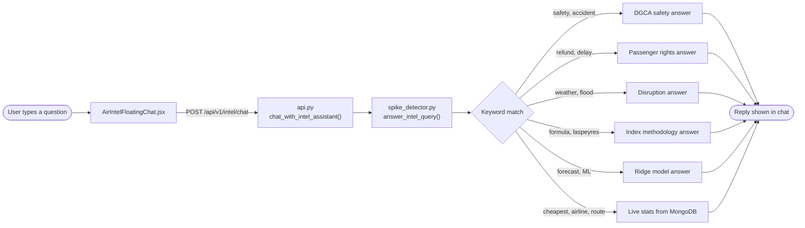
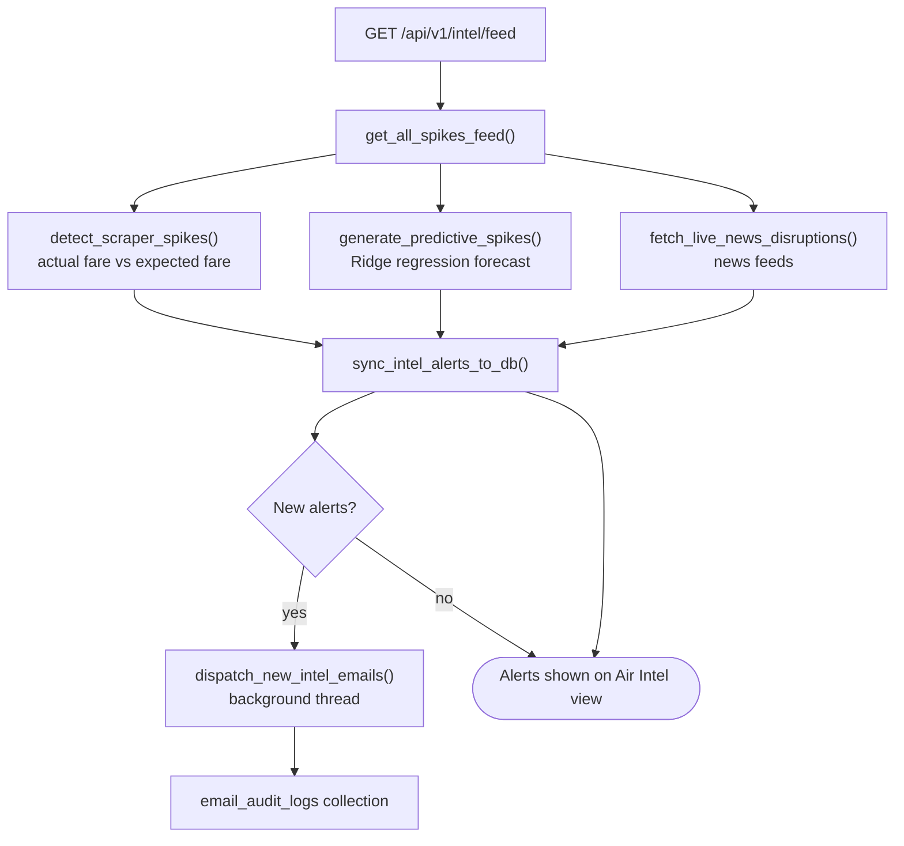

# Airpulse – Project Workflow

This file shows how data moves through Airpulse, from the fare scrapers to the dashboard and the alerts. The diagrams use [Mermaid](https://mermaid.js.org) and render automatically on GitHub and in VS Code's Markdown preview.

---

## 1. End-to-end workflow

---

## 2. Scrape cycle (every 30 minutes)

---

## 3. Request flow: from dashboard to data

---

## 4. Air Intel chatbot

---

## 5. Spike alert workflow

